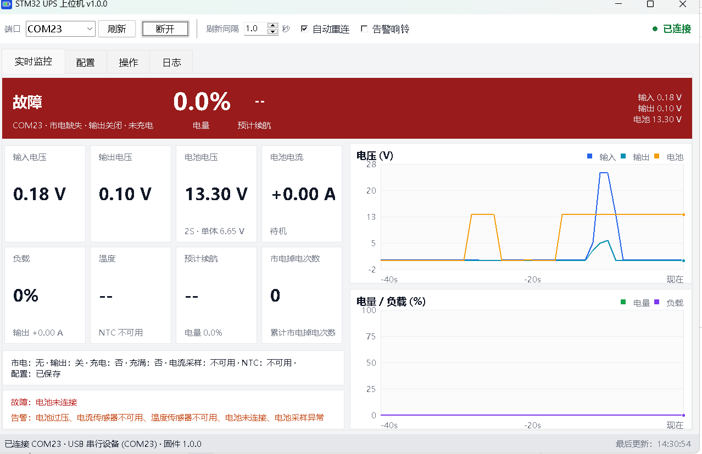
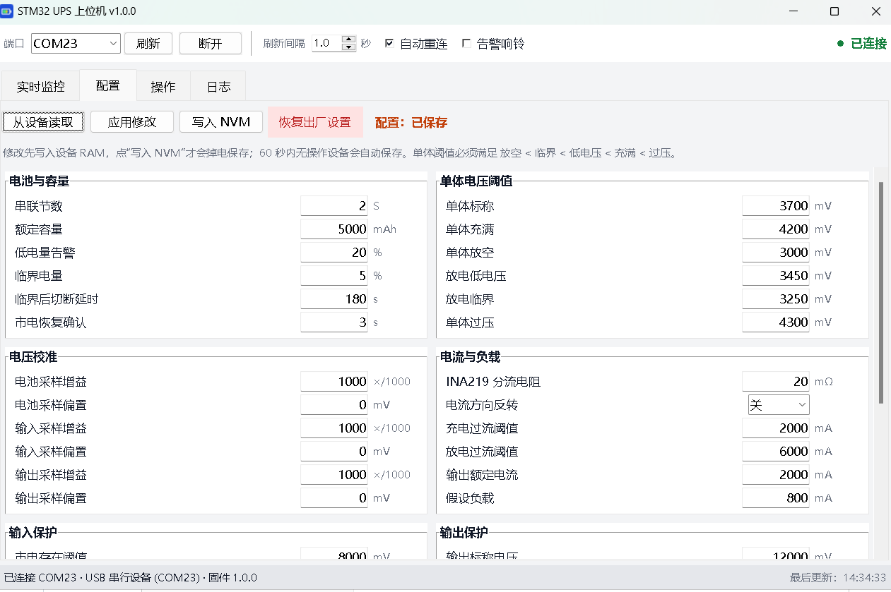

# STM32F103 12V DC UPS（立创·地阔星）

基于 **立创·地阔星 LCKFB-DKX-STM32F103C8T6** 的直流 UPS 监控与保护固件。Type-C 作为 **USB 2.0 全速 CDC 设备口** 与受电主机通信：既可以被 Linux/NAS 通过 NUT 直接识别，也提供一套 JSON 扩展命令给上位机做精确监控、配置、关机联动。

> **先看边界**
>
> 1. **Type-C 是数据口，不是 USB PD 口。** 本方案不做 PD 协议/电压协商。UPS 是自供电设备，主机通过 Type-C 的 D+/D- 与它通信。如果你的“供电设备”其实是一台 PD 充电器、需要通过 CC 线做 PD 协商，那需要额外的 PD 控制器（如 FUSB302/CH224K）和 PD 协议栈；当前固件不包含这部分。
> 2. **这是 DC UPS，不是 AC 逆变 UPS。** 默认面向 12V 路由器/NAS/小主机：12V 输入、2S 锂电、12V 输出（约 24W）。AC 侧只使用外置 12V 适配器，板子上没有市电。
> 3. **固件是 supervisory 控制器，不是充电器/保护板。** CC/CV 充电、过充/过放/短路保护必须由 BMS、充电模块、保险丝和 TVS 完成；固件只负责使能、监测、告警、切换和低压关机。
> 4. **参考硬件是设计建议，不是经过认证的电源原理图。** 默认引脚、分压比、电池参数都在 `include/board.h` 和运行时配置里，必须按你的实际硬件修改/校准。
> 5. 固件已通过编译、主机侧协议测试和计量逻辑测试；**尚未在真实功率级、电池和主板上做过实测**。请按 `docs/hardware.md` 的 bring-up 顺序，用限流电源和假负载逐项验证。

---

## 功能

- **供电状态机**：市电优先、掉电快速使能升压、临界电量延时切断、AC 恢复后自动恢复输出（含 10 s 安全保持）。
- **电池管理**：INA219 库仑计 + OCV 校正；2S/3S/4S 及 LiFePO4 阈值可配；充满/放空检测；运行时估算。
- **保护**：输入过压、输出过压/欠压、充放电过流、过温、电池缺失、传感器失效；分级为“告警”和“切断输出”，过流/输出异常带 3 次自动重试与长按复位。
- **Type-C 通信**：
  - **Megatec/Q1 兼容**：`Q1`、`F`、`I`、`Q`、`T`、`TL`、`T<n>`、`CT`、`C`、`S<n>[R<m>]`，NUT `nutdrv_qx` 的 `megatec` 协议可直接用。
  - **JSON 扩展**：`XID`、`XSTATUS`、`XCONFIG`、`XSET`、`XSAVE`、`XRESET`、`XSHUTDOWN`、`XCANCEL`、`XTEST`、`XBEEP`。
- **掉电安全配置**：最后 2 个 1 KiB Flash 页双页交替 + CRC32，写入时先写数据、最后写 magic；写一半掉电不会丢掉上一份配置。
- **人机界面**：三颗外接 LED、板载 PC13 心跳、蜂鸣器、按键（短按静音，长按清故障/取消关机）。
- **工程化**：IWDG 看门狗、传感器滤波、ADC 校准、NVM 版本管理、串口调试（可选）、主机侧单元测试。

---

## 快速开始

### 1. 接线

默认引脚在 [`include/board.h`](include/board.h)，完整参考硬件在 [`docs/hardware.md`](docs/hardware.md)。最小接线如下：

| 功能 | STM32 引脚 | 说明 |
|---|---|---|
| 电池电压采样 | PA0 | 100k / 33k 分压 + 100 nF |
| 输入电压采样 | PA1 | 100k / 15k 分压 + 100 nF |
| 输出电压采样 | PA2 | 100k / 30k 分压 + 100 nF（保证 13.5V 不超 ADC 量程） |
| 电池 NTC | PA3 | 10k NTC 到 GND，10k 上拉到 3.3V |
| OUT_EN | PA4 | 高有效，建议硬件上拉保证复位期间输出不断 |
| BOOST_EN | PA5 | 高有效，升压使能 |
| CHG_EN | PA6 | 高有效，充电模块使能/高边 P-MOS 驱动 |
| FAN_EN | PA7 | 可选风扇，高有效 |
| BUZZER | PA8 | NPN 驱动，高有效 |
| CHG_STAT | PB0 | 充电中，开漏低有效，内部上拉 |
| CHG_DONE | PB1 | 充满，开漏低有效，内部上拉 |
| BUTTON | PB5 | 对 GND，内部上拉；短按静音，长按 3 s 清故障/取消关机 |
| I2C1 | PB6/PB7 | INA219：电池 0x40，输出可选 0x41 |
| AC_CUT_EN | PB8 | 可选，高有效；真实电池切换自检用 |
| AC_OK | PB10 | 高有效，适配器存在检测；建议光耦/比较器 |
| LED_AC/BAT/FAULT | PB12/PB13/PB14 | 外部 LED，默认低电平点亮（见 board.h） |
| LED_STATUS | PC13 | 板载 LED，心跳 |
| USB D-/D+ | PA11/PA12 | Type-C 数据口 |
| UART 调试 | PA9/PA10 | 可选，`UPS_DEBUG_UART=1` 时 115200 8N1 |
| SWD | PA13/PA14 | 保留测试点；本工程通过 UART ISP 烧录 |

> **Type-C 注意**：地阔星板上 Type-C 通常直连 PA11/PA12，CC1/CC2 需要 5.1k 下拉（板子若有就不用加）。用万用表确认 D+/D- 确实到 PA12/PA11。VBUS 不要直接并联到 UPS 的 5V 轨；若需要，串肖特基二极管，避免主机和 UPS 互相回灌。详见硬件文档。

### 2. 编译

安装 PlatformIO 后：

```sh
pio run
```

默认环境 `bluepill_f103c8`，Arduino Core STM32 + LTO。链接脚本 `ldscript/stm32f103c8_nvm.ld` 把 Flash 限制为 **62 KiB（63,488 字节）**，最后 2 KiB 留给 NVM；当前 `.bin` 约 54.9 KB，静态 RAM 约 6.6 KiB。不要去掉这个链接脚本，否则配置区可能被代码覆盖。

UART 上传脚本 `tools/upload_uart_flags.py` 会给 `stm32flash` 加 `-e 62 -v`：只擦 62 个应用页（保留 NVM 配置）并在写入后校验；它仅在 `upload_protocol = serial` 时生效。

如果 PlatformIO 默认数据目录所在磁盘空间不足，可把 core 目录放到其他盘：

```sh
set PLATFORMIO_CORE_DIR=E:\platformio
pio run
```

### 3. 烧录

当前 `platformio.ini` 使用 **UART ISP**（不需要 ST-Link）：

1. BOOT0=1、BOOT1=0，按一次 RESET；
2. USB-TTL 3.3V：适配器 TX → PA10，RX → PA9，GND 共地；
3. `pio run -t upload --upload-port COMx`；
4. 烧完 BOOT0=0，再 RESET。

详细步骤和常见问题见 [`FLASH_UART.md`](FLASH_UART.md)。上传脚本会追加 `-e 62 -v`：只擦应用区并做写后校验，保留最后 2 KB 的 NVM 配置页。

### 4. 上位机监控

Windows 图形上位机（Python + tkinter）：

```sh
python host/ups_gui.py --port COM23
```

也可以直接运行打包好的 `host/dist/STM32-UPS-Monitor.exe`，不需要安装 Python。界面包含实时监控（状态、电压/电流/温度、故障告警、滚动曲线）、配置读写（39 项参数 + 写入 NVM）、操作（蜂鸣器、电池自检、计划切断）和日志/CSV 记录。详见 [`host/README.md`](host/README.md)。

命令行工具：

```sh
pip install -r host/requirements.txt
python host/ups_monitor.py --port COM7
python host/ups_monitor.py --port COM7 --watch
python host/ups_monitor.py --port COM7 --json
```

输出示例：

```text
ON BATTERY  AC off  output on  battery 87.3% (7.81 V)
input 0.00 V  output 11.98 V  battery current -0.42 A (load)
load 38%  temperature 25.3 C  runtime 1h 41m  AC failures 2
...
```

配置与关机联动：

```sh
python host/ups_monitor.py --set low_pct=25 --set cutoff_grace_s=240 --save
python host/ups_monitor.py --shutdown-after 60 --restore-after 300 --yes
python host/ups_monitor.py --cancel
```

`--port` 省略时会自动找 `0483:5740` 的 STM32 CDC 口。也可以直接使用 `XSTATUS`/`XCONFIG` JSON。





### 5. NUT（Linux/NAS）

```sh
sudo cp host/nut/99-stm32-ups.rules /etc/udev/rules.d/
sudo cp host/nut/ups.conf /etc/nut/ups.conf   # 合并，而不是覆盖已有配置
sudo systemctl restart nut-server
upsc stm32ups
```

NUT 使用 `nutdrv_qx` + `protocol = megatec`，详细说明见 [`host/nut/README.md`](host/nut/README.md)。如果不用 NUT，可用 `host/ups_guard.py` 在低电量时执行关机命令：

```sh
sudo python3 host/ups_guard.py --threshold 20 --execute \
    --shutdown-cmd "/sbin/shutdown -h now"
```

默认是 **dry-run**，不加 `--execute` 不会真的关机。systemd 示例在 `host/systemd/`。

---

## 通信协议速查

Q1 回包示例（NUT Megatec 格式）：

```text
(012.0 012.0 012.0 030 50.0 07.80 25.3 00001001\r
```

固定 7 个数值域 + 8 位状态，状态位顺序 **b7…b0**：

| 位 | 含义 |
|---|---|
| b7 | 市电失败/在电池上 |
| b6 | 电池低（仅电池供电时置位） |
| b5 | Boost/Buck 工作 |
| b4 | UPS 故障 |
| b3 | 待机式 UPS（本机固定为 1） |
| b2 | 电池测试中 |
| b1 | 关机计划生效 |
| b0 | 蜂鸣器使能 |

扩展命令（`\r\n` 结束，返回 JSON）：

```text
XSTATUS
{"ok":true,"state":"battery","ac":false,"output":true,"soc_x10":873,...}

XSET low_pct=25
{"ok":true,"key":"low_pct","saved":false}

XSAVE
{"ok":true}

XSHUTDOWN 60 300
{"ok":true,"shutdown_in_s":60,"restore_in_s":300}
```

`XSET` 只改 RAM；**60 秒**后自动保存，或立即 `XSAVE`。完整字段、配置键、错误码见 [`docs/protocol.md`](docs/protocol.md)。

---

## 配置与默认值

默认值面向 **2S 锂离子（7.4 V 标称，8.4 V 充满，5000 mAh）**：

| 项 | 默认 |
|---|---|
| 节数 / 容量 | 2 / 5000 mAh |
| 低电量 / 临界电量 | 20 % / 5 % |
| 临界后切断延时 | 180 s |
| 单体满/空/低/临界/过压 | 4200 / 3000 / 3450 / 3250 / 4300 mV |
| 输入存在/标称/最大 | 8.0 / 12.0 / 16.0 V |
| 输出标称/欠压/过压 | 12.0 / 10.5 / 13.5 V |
| 充电/放电电流上限 | 2.0 / 6.0 A |
| 输出额定电流 | 2.0 A |
| 充电温度上限 / 放电范围 | 45 °C / −10…60 °C |
| 过温故障 | 70 °C |
| INA219 分流电阻 | 20 mΩ（正电流=充电） |
| NTC | 10 kΩ，B=3950，启用 |
| 蜂鸣器 / 自动恢复 | 开 / 开 |

修改后务必 `XSAVE`。**换 3S/4S 或 LiFePO4 时，必须先改充电器、分压电阻和这些阈值，再上电池。** 具体改法见 [`docs/hardware.md`](docs/hardware.md#10-适配-3s4s-与-lifepo4)。

---

## 保护与状态机

状态：`Boot → Online ↔ OnBattery → LowBattery → Shutdown / Fault`。

- 市电掉电：AC_OK 引脚去抖 30 ms 后立即拉高 BOOST_EN、关闭充电；输出依靠硬件 ORing/电容保持。
- 市电恢复：稳定 `ac_restore_s`（默认 3 s）后才转回市电；2 s 后再关升压。
- 低电量：SoC ≤ 20 % 或放电电压低 → 告警；SoC ≤ 5 % / 临界电压 → 启动 `cutoff_grace_s` 延时，期间可通过 NUT/`C`/按键取消；到期切断输出。
- 故障：输入过压、>70 °C、放电/负载过流、输出过压/欠压、电池缺失、电池电压传感器失效 → 切断输出并置 Q1 故障位。过流/输出异常最多自动重试 3 次，之后需要长按 3 s 或重新上电。
- 电池过压、充电过流、温度不允许充电、充电器无响应等只告警并禁止充电，**不切断负载**。
- 主机 `S<n>` / `XSHUTDOWN`：按时间切断；带 `R<m>` 时按“至少 m 分钟 + 恢复后 10 s”恢复；`C`/`XCANCEL` 取消。

细节和完整保护矩阵见 [`docs/design.md`](docs/design.md)。

---

## 校准

默认分压比是理想值，实际电阻有误差；建议第一次上电用万用表校准：

1. 只给 5V/3.3V，不接功率级，USB 能枚举；
2. 读取 `XCONFIG` 和 `XSTATUS`；
3. 用万用表测电池/输入/输出电压，计算：
   `scale = 实际电压 / 当前读数 × 1000`；
4. `XSET vbat_scale=...`（或 `vin_scale`/`vout_scale`），偏差用 `*_offset` 修正；
5. `XSAVE`。

电流：确认 INA219 的正方向（默认 **正电流 = 充电**）。如果接反，`XSET ina_invert=1`。分流电阻值必须和实际一致（`shunt_mohm`）。

---

## 工程结构

```text
include/board.h         引脚、硬件能力、分压比、极性
include/settings.h      配置结构、默认值、校验
include/telemetry.h     遥测/故障/告警定义
src/app.cpp             状态机、保护、输出/充电策略、CommHost
src/battery.cpp         库仑计 + OCV + 运行时
src/sensors.cpp         ADC 滤波、NTC、INA219
src/ina219.cpp          INA219 驱动
src/nvm.cpp             双页 Flash 配置存储
src/settings.cpp        配置默认值/校验/键值应用
src/comm.cpp            Megatec/Q1 + JSON 命令
src/protocol_format.cpp Q1/F/I 报文格式化（纯函数）
src/ui.cpp              LED/蜂鸣器/按键
host/ups_monitor.py     监控/配置 CLI
host/ups_gui.py         Windows 图形上位机
host/ups_guard.py       低电量关机守护
host/nut/               NUT + udev
test/                   主机侧测试
docs/                   硬件、协议、设计
ldscript/               预留 2 KiB NVM 的链接脚本
```

---

## 测试

```sh
python -m py_compile host/ups_monitor.py host/ups_guard.py host/ups_gui.py

# Windows
test\run_tests.cmd

# Linux/macOS
./test/run_tests.sh
```

测试覆盖：

- Q1/Q1 故障位/F/I 报文的字段顺序、长度和 NUT 解析要求；
- `S<n>R<m>`、`T/TL/T<n>`、`C/CT` 解析；
- `XSTATUS`/`XCONFIG`/`XSET`/`XSHUTDOWN` 等 JSON 命令；
- SoC 库仑计、OCV 查表、低电量/临界判定、运行时估算；
- 配置校验和 CRC。

固件编译：

```sh
pio run
```

当前结果：**Flash 约 54,948 / 63,488 字节**（预留 2 KiB NVM 后，余量约 8 KiB），**静态 RAM 约 6.6 / 20 KiB**。主机测试全部通过；真实功率级仍需按硬件文档逐项验证。

---

## 适配 3S/4S 与 LiFePO4

简表（详见硬件文档）：

| 项目 | 2S Li-ion（默认） | 3S Li-ion | 4S LiFePO4 |
|---|---|---|---|
| 电池标称 | 7.4 V | 11.1 V | 12.8 V |
| 充电器 | 8.4 V CC/CV | 12.6 V CC/CV | 14.6 V CC/CV |
| 电池分压 | 100k/33k | 100k/22k 或 100k/27k | 100k/22k 或重新计算 |
| 输入 | 12 V | 19 V（充电器输入要求） | 19–24 V |
| 输出级 | 2S→12V 升压 | 3S→12V buck-boost | 4S→12V buck |
| 关键配置 | `cells=2` | `cells=3` + 改 `cell_*` | `cells=4` + LiFePO4 `cell_*` |

LiFePO4 的 OCV 曲线与代码里的 Li-ion 表不同，电压法 SoC 会偏；库仑计是主方法，OCV 只做慢校正，建议按实际电芯调整阈值并在整机上学容量。**任何化学体系都必须有匹配的 BMS 和 CC/CV 充电器。**

---

## 安全警告

- 锂电池能量密度高。接电池前先确认极性、保险丝、BMS、充电截止电压；第一次测试用限流电源和假负载，不要直接接真实设备。
- 固件不能替代 BMS/充电器/保险丝/ TVS。尤其是单体过充、过放、短路保护，必须由硬件完成。
- 输出 ORing 和升压使能要设计成“MCU 复位/掉电时仍能保持输出”的 fail-safe；否则复位/死机可能让负载断电。
- 如果做 AC 侧（市电）任何改动，必须考虑隔离、爬电距离和安规；本设计只接外置低压 DC 适配器。
- Type-C 是数据口，主机 VBUS 不要回灌 UPS 电源轨；用二极管或直接不接。
- 烧录后把 BOOT0 恢复为 0，否则复位后进不了用户程序。

---

## 参考

- [立创·地阔星 STM32F103C8T6 入门手册](https://wiki.lckfb.com/zh-hans/dkx-stm32f103c8t6/beginner/)
- [立创商城地阔星产品页（引脚/原理图资料入口）](https://item.szlcsc.com/product/jpg_24005615.html)
- [NUT Megatec Protocol information](https://networkupstools.org/protocols/megatec.html)
- [NUT 项目](https://github.com/networkupstools/nut)
- [STM32F103 USB HID UPS 参考项目（MIT）](https://github.com/MysteryDove/STM32_UPS_HID_PowerDevice)
- [Waveshare UPS Module Mini for STM32 示例](https://www.waveshare.com/wiki/Template:UPS_Module_Mini_for_stm32_use)

> 本项目与上述厂商/项目无隶属关系；参考链接仅用于硬件与协议对照。
