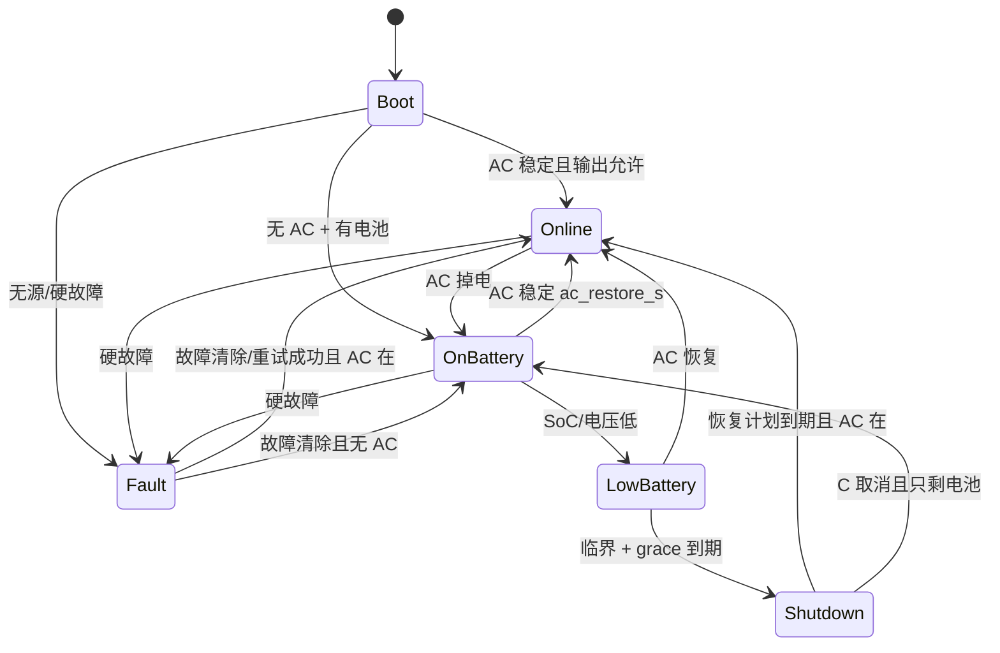

# 设计与实现说明

## 1. 总体结构

```text
sensors.cpp ── ADC/NTC/INA219 ──┐
                                ▼
battery.cpp ── SoC/低电量 ──► app.cpp ──► ui.cpp
                                │  ▲
config_store.cpp / nvm.cpp ─────┘  │
                                   └── comm.cpp ── USB CDC ── Type-C
```

- `app.cpp` 是唯一的状态机/策略层，输入是传感器和配置，输出是 GPIO 和通信状态；
- `battery.cpp`、`protocol_format.cpp`、`settings.cpp` 不依赖 Arduino，可在主机上编译测试；
- `comm.cpp` 只依赖 Arduino `Stream` 抽象，主机侧用假串口测试；
- `sensors.cpp` 负责所有模拟/I²C 细节，向上只给 `SensorSample`；
- `nvm.cpp` 用裸 Flash 双页存储，绕开 STM32duino EEPROM 在 F1 上“每字节擦整页”的问题。

## 2. 状态机



补充：

- `Boot` 持续 800 ms，期间不做硬故障判断，避免上电瞬态误动作；
- `Shutdown` 表示输出被计划/保护切断，但 MCU 还活着；
- `Fault` 优先于 `Shutdown` 显示；
- 主机 `S` 命令在输出仍开启时只置“关机计划”位，不立即切换状态；
- 状态只用于显示/上报，真正的输出门控在 `updateOutputs()`。

## 3. 主循环时序

| 任务 | 周期 | 位置 |
|---|---|---|
| ADC 四路采样 + 滤波 | 20 ms | `Sensors::poll` |
| NTC 温度换算 | 100 ms | `Sensors::poll` |
| INA219 读电流/电压 | 250 ms | `Sensors::poll` |
| AC 去抖 | 每 loop（约 <1 ms） | `updateAc` |
| 控制/保护/状态机 | 50 ms | `control` |
| 协议收包 | 每 loop，单次最多 64 字节 | `Protocol::poll` |
| UI/按键 | 每 loop | `Ui::poll` |
| 运行时间统计 | 1 s | `updateRuntime` |
| 配置/状态持久化 | 事件后 5 s / 30 min | `saveStateIfDue` |
| 配置自动保存 | 60 s | `ConfigStore::tick` |
| 看门狗 | 2 s | IWDG |

`Sensors::poll` 内部用 8 次 ADC 过采样 + 8 点滑动平均；NTC 再做一阶滤波。ADC 在 50 Hz 控制下不会成为瓶颈。

## 4. AC 检测与切换

- `readAcRaw` 同时要求：`AC_OK` 引脚有效 **且** 输入电压 ≥ `vin_present_mv`；没有 AC_OK 引脚时只看电压；
- 掉电去抖：有 AC_OK 引脚 30 ms，仅 ADC 100 ms；
- 恢复去抖：`ac_restore_s` 秒（默认 3 s），防止适配器抖动反复切换；
- 掉电瞬间：
  1. 记录故障电压（Q1 的 input fault voltage）；
  2. `ac_fail_count++`；
  3. 如果输出开着，立即拉高 `BOOST_EN`；
  4. 立即关闭 `CHG_EN`；
  5. 输出检查进入 2 s 宽限期，避免切换跌落误判。
- 恢复时：
  1. 保持升压 2 s，等适配器稳定接管；
  2. 2 s 后关闭升压；
  3. 如果之前有低电量关机计划，取消（输出仍然开着）；
  4. 如果输出被低电量切断，等待市电稳定并再保持 10 s 后恢复；
- 真正的“无缝”由硬件 OR-ing + 输出电容 + 升压环路保证；固件只负责尽快使能。

## 5. 输出、升压、充电策略

```text
blocked = faults != 0
can_output = !output_cut && !blocked && (ac_present || battery_present)
boost_on   = output_on && (!ac_present || test_active || 切换保持窗口)
charge_on  = ac_present && battery_present && !battery_ov && !blocked
             && !test_active && charge_temp_ok && !charge_oc_block
```

- `output_cut` 只由关机/低电量切断设置，不由故障设置；故障通过 `blocked` 切断输出。故障清除后输出可以自动恢复（若 `auto_recover` 允许）；
- `BOOST_EN` 在市电掉电时由 `updateAc` 立即置位，不等待 50 ms 控制周期；
- 充电使能是“允许”而不是 CC/CV 控制；电流/电压闭环在充电模块；
- 电池过压、充电过流、温度不允许、测试中、故障中都会阻止充电，但**不切断负载**（电池过压除外，见保护矩阵）；
- 没有电池时，市电下仍可输出（适配器直接供电），但会告警；市电掉电立即判电池缺失故障并切断。

## 6. 保护矩阵

| 条件 | 输出 | 充电 | 上报 | 恢复 |
|---|---|---|---|---|
| 输入过压 `vin > vin_max` | 切断 | 禁止 | `FAULT_INPUT_OV`、Q1 failed | 输入回到正常范围后自动 |
| 温度 > `temp_fault` | 切断 | 禁止 | `FAULT_OVER_TEMP`、Q1 failed | 温度降到故障点以下自动 |
| 放电/负载过流 | 切断 | 禁止 | `FAULT_OVER_CURRENT`、Q1 failed | 30 s 后自动重试，最多 3 次；之后长按 |
| 输出欠压/过压 | 切断 | 禁止 | `FAULT_OUTPUT_UV/OV`、Q1 failed | 5 s 后自动重试，最多 3 次；之后长按 |
| 电池缺失且无市电 | 切断 | 禁止 | `FAULT_BATTERY_MISSING` | 接电池/市电恢复 |
| 电池电压采样失效 | 若在电池上则按缺失处理 | 禁止 | `WARN_BATTERY_SENSOR` / `FAULT_BATTERY_MISSING` | 传感器恢复 |
| 电池过压 | 保持（市电） | 禁止 | `WARN_BATTERY_OV` | 带回差自动 |
| 充电过流 | 保持 | 禁止 30 s | `WARN_CHARGE_OVERCURRENT` | 30 s 后重试 |
| NTC 失效 | 保持 | 禁止 | `WARN_TEMP_SENSOR` | 传感器恢复 |
| INA219 失效 | 保持 | 允许 | `WARN_CURRENT_SENSOR` | 自动重试 I²C |
| 充电器无状态 | 保持 | 允许 | `WARN_CHARGER_STALE` | 状态恢复 |
| 配置无效 | 保持（用默认值） | 按默认 | `WARN_CONFIG_INVALID` | `XSAVE`/自动保存 |
| SoC ≤ `low_pct` | 保持 | 允许 | Q1 LB（仅电池）、`low` | AC 恢复/充电 |
| SoC ≤ `critical_pct` 或临界电压 | 延时 `cutoff_grace_s` 后切断 | 按状态 | Q1 LB + shutdown | AC 恢复 10 s 后 |
| 电池 ≤ `cell_empty` | 立即切断 | 禁止 | Q1 LB + shutdown | 需 AC 恢复 |
| 市电掉电 | 保持（升压） | 禁止 | Q1 b7 | AC 稳定恢复 |
| 主机 `S<n>` | 到期切断 | 按状态 | Q1 b1 | `C`/恢复计划 |
| 主机 `S<n>R<m>` | 到期切断 | 按状态 | Q1 b1 | m 分钟后/AC 恢复 + 10 s |

故障自动重试由 `auto_recover` 控制；设为 0 时第一次过流/输出故障就会锁存，需要长按 3 s 或重新上电。长按会清除锁存故障和关机计划，但硬件条件仍然存在时会再次触发。

## 7. 电池 SoC

### 7.1 主算法：库仑计

INA219 每分钟/每 250 ms 读一次电流，按：

```text
0.1% 电量变化 = ∫ I dt / (容量 mAh × 3600)
```

累加。正电流定义为充电。实现中用 `int64_t` 累加 µA·s 余数，避免小电流被截断。

### 7.2 辅助：OCV 校正

- 代码内置一张 Li-ion 单体 OCV 表（3.00 V→0%，4.20 V→100%）；
- 连续 60 s 电流 <100 mA 时，每 10 s 向 OCV 估算值缓慢修正；
- 没有 INA219 时，放电状态下每 30 s 向 OCV 走 0.1%；
- 充电时不用 OCV（端电压被充电器抬高）。

### 7.3 充满/放空

- 有 `CHG_DONE` 引脚：充电中 DONE 有效 → 100%；
- 无 DONE：电压接近满电且尾电流 < `max_charge_ma/30` 持续 60 s → 100%；
- 放电到 `cell_empty × cells` → 0%，并触发立即切断；
- SoC 每 30 min 或 AC 切换/关机时持久化。

### 7.4 低电量判定

- SoC ≤ `low_pct×10` → 低；
- 放电时电压 ≤ `cell_low × cells` 持续 5 s → 低（电压法有 5 s 去抖）；
- SoC ≤ `critical_pct×10` 或放电电压 ≤ `cell_critical × cells` 持续 2 s → 临界；
- 临界后启动 `cutoff_grace_s`（默认 180 s）；期间主机可通过 NUT/JSON 完成关机；
- 若电压到 `cell_empty × cells`，不等待 grace，立即切断；
- 充电时 Q1 的 b6 不置位，避免 upsmon 在充电时误关机。

### 7.5 运行时

- 余量 = `capacity_mAh × SoC`；
- 电池供电且有 INA219：用实际电池电流；
- 市电供电/无电流传感器：用输出功率 ÷ 电池电压 ÷ 0.9 估算；
- 无输出传感器时输出电流用 `assumed_load_ma` 估算；
- 上限 7 天，避免无意义的大数。

## 8. 配置存储

- `ldscript/stm32f103c8_nvm.ld` 将 Flash 限制为 62 KiB；
- 最后两页：`0x0800F800`（A）和 `0x0800FC00`（B）；
- 每页结构：magic/version/sequence/payload_len/reserved/CRC + `Settings` + `RuntimeState`；
- 写入流程：
  1. 目标页整页擦除（不是当前页）；
  2. 写 payload/header，magic 最后写；
  3. 回读并校验 CRC/sequence；
  4. 成功后才切换 current page；
- 任意时刻掉电，另一页仍是完整配置；
- 读取时选 sequence 最大的有效页；两页都无效则用默认值并告警；
- 配置在 `XSET` 后 60 s 自动保存，`XSAVE` 立即保存；状态每 30 min/事件后保存；
- 上传脚本 `tools/upload_uart_flags.py` 给 stm32flash 加 `-e 62`，避免烧录时擦掉 NVM 页，并加 `-v` 校验。

## 9. 通信与主机

- USB CDC 只做设备角色，不发 unsolicited 数据；
- Megatec 是 NUT 兼容层；JSON 是精确监控层；
- `Protocol` 单缓冲区 128 字节，超长行丢弃；
- JSON 响应缓冲 1400 字节，`XCONFIG` 约 800 字节；
- 只有收到命令才写 USB，避免主机不在时阻塞；
- NVM 写入会关中断 20–80 ms（F1 擦页），此时 USB 可能丢一两个包，NUT 下一次轮询会恢复；
- 看门狗 2 s，I²C 卡死/主循环卡死会复位。

## 10. 失败模式与 fail-safe

| 场景 | 行为 |
|---|---|
| MCU 复位（市电） | OUT_EN 硬件上拉保持输出；适配器继续供电 |
| MCU 复位（电池） | 要求 BOOST_EN 硬件上拉或升压常开，否则输出会短暂掉电；见硬件文档 |
| 固件卡死 | IWDG 2 s 复位；输出由硬件默认状态决定 |
| 充电器失控 | BMS 过充保护；固件在电池过压时拉低 CHG_EN |
| 电池过放 | BMS 保护；固件先按 LB/临界策略切断 |
| 负载短路 | 硬件保险丝/负载开关限流；固件过流 1 s 切断 |
| Type-C 拔掉 | 不影响供电；命令不再响应 |
| Flash 写失败 | 保留旧配置；告警；5 min 后重试 |
| 两页配置都损坏 | 使用默认 2S 参数；告警；需重新 `XSAVE` |

## 11. 已知局限与后续

- 只测电池组总电压，不测单体；BMS 必须做单体保护和均衡；
- 没有 AC 逆变；没有 USB PD；
- 不是安全认证的充电器/保护板；
- NTC 失效时选择“禁止充电但保持输出”，是可用性优先；高安全场景可改为切断；
- LiFePO4 的 OCV 表需要自行替换；
- 无输出 INA219 时负载百分比/运行时是估算；
- 关机后 MCU 仍由 5V 辅助电源供电，长期停电会消耗电池；可加自锁电源/STOP 模式；
- 真实电池切换自检需要 AC_CUT 硬件；
- 运行时的关机计划、锁存故障和 `C` 取消状态不持久化；IWDG/复位后会重新评估，可能恢复输出（OUT_EN 硬件上拉）。需要跨复位保持关机时，应把标志存入 `RuntimeState` 并在 `begin` 恢复；
- 未在真实功率级上验证，必须先按硬件文档 bring-up。
