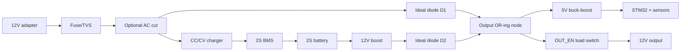

# 参考硬件设计（12 V DC UPS）

> 这是一份 **可落地的参考方案**，用于说明固件默认引脚和参数从哪来。它不是经过安规/EMC/热设计验证的量产原理图。第一次打板/搭棚请按本节末尾的 bring-up 顺序，用限流电源和假负载逐项验证。

## 1. 目标规格

| 项目 | 默认值 |
|---|---|
| 输入 | 12 V / 3 A 外置 DC 适配器（5.5×2.1 或端子） |
| 电池 | 2S 锂离子，7.4 V 标称，8.4 V 充满，2S2P 18650 5000 mAh |
| 输出 | 12 V / 2 A（24 W），带负载开关 |
| 通信 | Type-C USB 2.0 FS CDC，虚拟串口，115200 8N1 |
| 备电时间 | 取决于负载；24 W 下约 0.8–1.2 h（含效率） |
| 保护 | BMS + 保险丝 + TVS + 固件监督 |

电池化学、串数和输出功率都可以改，但 **充电器、功率级、分压电阻和固件阈值必须一起改**，不能只改软件。

## 2. 框图

```text
 12V adapter                                                  12V load
   │                                                              ▲
   ├──[F1/TVS]──[optional AC_CUT]──┬──[ideal diode D1]───────────┤
   │                               │                              │
   │                               └──[CC/CV charger]──[BMS]──[2S pack]
   │                                                              │
   │                                                       [12V boost]
   │                                                              │
   │                                                       [ideal diode D2]
   │                                                              │
   │                                                     ┌────────┘
   │                                                     ▼
   └───────────────────────────────────────────────► OR-ing node
                                                          │
                                       ┌──────────────────┴──────────────┐
                                       │                                 │
                                  [5V buck-boost]                  [OUT_EN load switch]
                                       │                                 │
                                  STM32 / sensors                    output connector
```

Mermaid 版本：



## 3. 功率路径

### 3.1 市电优先与切换

推荐使用两个 **理想二极管模块/低 Vf 肖特基** 做 OR-ing：

- 适配器路径：12.0 V 输入 → D1 → 输出节点；
- 电池路径：2S → 升压到约 11.8 V → D2 → 输出节点；
- 适配器存在时，D1 侧电压高于 D2，适配器供电；
- 适配器掉电时，D2 立即接管，输出只下降一个二极管差 + 升压跌落；
- 固件在检测到 AC_OK 失效后 **30 ms 内**拉高 `BOOST_EN`，并用输出电容撑过切换。

如果使用普通 SS54（2 A 时 Vf≈0.45 V）：

- 适配器路径输出约 11.55 V；
- 升压设 11.8 V，经 D2 输出约 11.35 V；
- 切换压差约 0.2 V，绝大多数 12 V 设备可接受。

如果负载对 12 V 很敏感，使用理想二极管（如 LM66100/TPS2121 类）或把升压设到 11.9 V、适配器 12.0 V，压差可以做到 <0.1 V。

> **无缝切换靠硬件。** 固件只能尽快使能升压，不能替代 OR-ing、输出电容和合适的升压环路。若要“零中断”，可以让升压在市电时也保持开启（OR-ing 会让它空载），代价是几 mA 静态电流。

`OUT_EN` 控制一个高边 P-MOS 负载开关。**硬件上建议给 OUT_EN 加上拉**，这样 MCU 复位/未上电时负载仍然有电；MCU 启动后再决定是否切断。若你的安全策略要求复位即断电，则改为下拉并记录。

### 3.2 充电

- 2S 锂离子：8.4 V CC/CV，最大 2 A（0.4C，5000 mAh）；
- 充电器输入从 12 V 适配器取电；若使用 3S/4S，改用 19–24 V 输入和对应 CC/CV；
- 充电器输出经过 **2S BMS** 再到电池；BMS 负责单体过充、过放、短路、均衡；
- `CHG_EN` 控制充电器 EN 或输入高边 P-MOS：
  - 高有效；硬件下拉，默认关闭；
  - 如果充电模块没有 EN，必须加 P-MOS/继电器，否则固件无法在过温/过压时停止充电；
- `CHG_STAT`/`CHG_DONE` 接充电器的开漏状态脚（低有效），10 kΩ 上拉到 3.3 V；
  - 只有 LED 没有逻辑输出时，可以用光耦取 LED 电流，或者把 `UPS_HAS_CHG_STAT/DONE` 设为 0；
  - 没有状态脚时，固件靠“电压 + 尾电流”判断充满。

**推荐充电器**：带 EN 和 CHRG/STDBY 的 2S 8.4 V 2 A CC/CV 模块。TP5100 这类模块便宜，但通常没有 EN，需要外加 P-MOS，且注意散热。

### 3.3 5V 辅助电源

STM32 板、INA219、LED 等需要 5 V/3.3 V。推荐：

- 一颗 **5 V 1 A buck-boost**，输入从 OR-ing 节点（负载开关之前）或电池取电；
- 这样即使 `OUT_EN` 切断负载，MCU 仍然活着，可以响应 Type-C 命令和 AC 恢复；
- 5 V 进开发板 5V 脚，板载 ME6211 产生 3.3 V；
- 不要用 Type-C 的 VBUS 直接给 UPS 5V 轨供电；如果主机 VBUS 需要参与，串肖特基二极管，避免回灌；
- 控制器静态电流约 30–60 mA；长时间停电时 BMS 最终会保护。若要进一步降功耗，可在关机态进入 STOP 模式或加自锁电源（见“局限”）。

## 4. Type-C 通信口

- 使用 **USB 2.0 全速设备**：D- → PA11，D+ → PA12；
- Type-C 插座 CC1/CC2 各 5.1 kΩ 下拉到 GND（UFP 设备角色）；地阔星板通常已经装了，万用表确认；
- VBUS 不建议接到 UPS 5V；如果要接，串肖特基；
- D+/D- 加 USBLC6-2SC6 之类 ESD 保护，走线尽量短、等长；板上通常已有 22 Ω；
- **不要**把 Type-C 当 PD 口：没有 CC 逻辑、没有 PD PHY、没有 5–20 V 协商；
- UART 烧录用的是 PA9/PA10 排针，不是 Type-C。烧录说明见 `FLASH_UART.md`。

> 有些低成本 Blue Pill 类板子的 Type-C 只引了 VBUS/GND。拿到地阔星后先用万用表确认 Type-C 的 D+/D- 是否到 PA12/PA11；如果不通，需要飞线或改用 UART 通信（固件目前只实现 USB CDC）。

## 5. 信号调理

### 5.1 分压

| 信号 | 分压 | 比例 | 满量程举例 | 固件宏 |
|---|---|---|---|---|
| 电池 PA0 | 100k / 33k | 4.030 | 2S 8.7 V→2.16 V；3S 12.9 V→3.20 V | `UPS_VBAT_DIV_*` |
| 输入 PA1 | 100k / 15k | 7.667 | 24 V→3.13 V | `UPS_VIN_DIV_*` |
| 输出 PA2 | 100k / 30k | 4.333 | 13.5 V→3.12 V | `UPS_VOUT_DIV_*` |

- 每个 ADC 节点加 **100 nF** 到 GND，靠近 MCU；
- 用 1% 电阻；输入分压注意功率（24 V 时 115 kΩ 上约 0.2 W，选 0.25 W 以上）；
- 4S 电池请把 VBAT 分压改为 100k/22k（14.6 V→2.63 V），并同步修改 `UPS_VBAT_DIV_NUM/DEN`；
- 上电后用 `XSET vbat_scale=...` 等做精细校准。

### 5.2 NTC

- 10 kΩ NTC（B=3950）贴在电池表面/电芯之间；
- 3.3 V → 10 kΩ → PA3 → NTC → GND；
- 固件按 Beta 公式换算，并做一阶滤波；
- 不接 NTC 时 `ntc_enabled=0`，但强烈不建议：充电温度保护会失效。

### 5.3 INA219

- 电池电流：INA219 模块地址 **0x40**，高边串在电池正极（BMS 之后）；
- 推荐 **0.02 Ω / 2 W** 四端/Kelvin 分流电阻；6 A 时约 0.72 W；
- IN+ 接系统/充电器侧，IN- 接电池侧：**正电流 = 充电**；
- INA219 总线电压最大 26 V；2S/3S/4S 都够用；
- 可选输出电流：第二片 INA219 地址 **0x41**，把 `UPS_HAS_OUTPUT_INA219` 设为 1 并重新编译；当前固件两片使用同一个 `shunt_mohm` 配置；
- 模块自带的 0.1 Ω 分流电阻要换成实际值，或用 `XSET shunt_mohm=100` 匹配；前者发热更小。

### 5.4 AC 存在检测

推荐光耦（同地但抗干扰）：

```text
12V ── 4.7k ── PC817 LED ── GND
                  │
3.3V ─────────────┴── 集电极
                       发射极 ──┬── PB10
                                └── 10k ── GND
PB10 ── 100nF ── GND
```

- 适配器存在 → PB10 高；拔掉 → 低；
- 固件 `AC_OK` 高有效、内部下拉；
- 24 V 输入把 4.7 kΩ 改成 10 kΩ；
- 也可以使用比较器（LM393）检测 12 V 分压；效果类似，注意阈值和迟滞；
- 没有 AC_OK 引脚时，`UPS_HAS_AC_OK_PIN=0`，固件退回输入电压 ADC 阈值，响应会慢一些。

### 5.5 充电状态

- CHRG/DONE 开漏，低有效；
- 3.3 V 通过 10 kΩ 上拉到 PB0/PB1；
- 如果模块的输出是 LED 阳极驱动，不要直接接 3.3 V/IO，需加三极管/光耦反相并调整 `UPS_CHG_STATUS_ACTIVE_LOW`；
- 没有状态脚时把 `UPS_HAS_CHG_STAT/DONE` 设为 0，固件仍可工作。

### 5.6 输出/升压/充电使能

| 信号 | 默认极性 | 硬件默认 | 说明 |
|---|---|---|---|
| OUT_EN PA4 | 高有效 | **上拉（保持输出）** | 高边 P-MOS 负载开关，经 NPN 驱动 |
| BOOST_EN PA5 | 高有效 | **上拉（保持输出，建议）** | 复位/未上电时升压仍工作；市电下让它空载（几 mA），换 fail-safe；也可用无 EN 的常开升压 |
| CHG_EN PA6 | 高有效 | 下拉（关） | 充电器 EN/输入 P-MOS |
| AC_CUT_EN PB8 | 高有效 | 下拉（AC 通） | 可选，继电器/P-MOS，真实电池测试用 |

P-MOS 高边驱动示例：MCU 高 → NPN 导通 → P-MOS 栅极拉低 → 导通；栅极加 10 kΩ 上拉到源极。注意 P-MOS 的 Vgs 额定值和栅极保护。

### 5.7 可选 AC_CUT

- 目的：让固件做一次真实的“断电→电池接管”自检（Megatec `T/TL`）；
- 位置：**AC_OK 和 VIN 采样之后**，OR-ing 和充电器之前；
- 器件：12 V 继电器（线圈加三极管/MOS + 续流二极管）或高边 P-MOS；
- 固件默认 `UPS_HAS_AC_CUT=0`，`T` 命令会返回失败（echo），不会假装测试成功；
- 装上后把宏设为 1，自检会：先开升压 → 等 150 ms → 切 AC → 运行 → 恢复 AC → 500 ms 后结束。

### 5.8 按键、LED、蜂鸣器

- 按键 PB5 对 GND，内部上拉；短按静音，长按 3 s 清故障/取消关机；
- 外部 LED 默认 **3.3 V → 1 kΩ → LED → GPIO**（低电平点亮）；如果接成 GPIO→LED→GND，把 `UPS_EXT_LED_ACTIVE_LOW` 设为 0；
- PC13 板载 LED 极性随地阔星版本不同；如果心跳反相，改 `UPS_ONBOARD_LED_ACTIVE_LOW`；
- 蜂鸣器用 NPN/达林顿驱动，PA8 高有效；有源蜂鸣器即可。

## 6. 完整引脚表

| 引脚 | 功能 | 方向/备注 |
|---|---|---|
| PA0 | VBAT_ADC | 模拟 |
| PA1 | VIN_ADC | 模拟 |
| PA2 | VOUT_ADC | 模拟 |
| PA3 | NTC | 模拟 |
| PA4 | OUT_EN | 输出，高有效 |
| PA5 | BOOST_EN | 输出，高有效 |
| PA6 | CHG_EN | 输出，高有效 |
| PA7 | FAN_EN | 输出，可选 |
| PA8 | BUZZER | 输出，高有效 |
| PA9 | UART TX | 调试 / 出厂 UART 烧录 |
| PA10 | UART RX | 调试 / 出厂 UART 烧录 |
| PA11 | USB DM | Type-C D- |
| PA12 | USB DP | Type-C D+ |
| PA13 | SWDIO | 可选 SWD 调试 |
| PA14 | SWCLK | 可选 SWD 调试 |
| PB0 | CHG_STAT | 输入，上拉，低有效 |
| PB1 | CHG_DONE | 输入，上拉，低有效 |
| PB5 | BUTTON | 输入，上拉，低有效 |
| PB6 | I2C1 SCL | INA219 |
| PB7 | I2C1 SDA | INA219 |
| PB8 | AC_CUT_EN | 可选，输出 |
| PB10 | AC_OK | 输入，高有效 |
| PB12 | LED_AC | 外部绿 LED |
| PB13 | LED_BAT | 外部橙 LED |
| PB14 | LED_FAULT | 外部红 LED |
| PC13 | LED_STATUS | 板载 LED |
| PB2 | BOOT1 | 启动模式 |
| 5V/3.3V/GND | 电源 | 由 5V buck-boost 供电 |

## 7. 参考 BOM

| 类别 | 建议 |
|---|---|
| 输入适配器 | 12 V / 3 A DC，5.5×2.1 或端子 |
| 输入保护 | 3 A 保险丝、SMBJ15A TVS、反接 P-MOS |
| 电池 | 2S2P 18650 5000 mAh（或 2S 锂聚合物） |
| BMS | 2S 10 A 带均衡、过充/过放/短路保护 |
| 充电器 | 2S 8.4 V 2 A CC/CV，带 EN + CHRG/STDBY |
| 升压 | 2S→12 V 5 A，带 EN（留 30–50% 余量） |
| OR-ing | 2× SS54 5 A 或理想二极管模块 |
| 负载开关 | P-MOS（2 A 选 AO3401A 级别；更大电流选低 Rds(on) 器件） |
| 5V 辅助 | 5 V 1 A buck-boost，宽输入 5.5–18 V |
| 电流检测 | INA219 模块 + 0.02 Ω 2 W 分流电阻 |
| AC 检测 | PC817 + 4.7 kΩ + 10 kΩ + 100 nF |
| NTC | 10 kΩ B=3950，贴电池 |
| 分压 | 1% 金属膜：100k×3、33k、30k、15k |
| USB 保护 | USBLC6-2SC6，CC 5.1 kΩ×2 |
| 指示/交互 | 3× LED + 1 kΩ，有源蜂鸣器 + NPN，轻触按键 |
| 可选自检 | 12 V 继电器或高边 P-MOS + 驱动 |

具体料号按你的采购渠道选；关键是电压/电流/功率余量和 1% 分压。

## 8. 校准

1. 只给控制板 5 V，不接功率级；USB 应能枚举。
2. 用万用表测实际 VBAT/VIN/VOUT，同时读 `XSTATUS`。
3. 计算 `scale = 实际电压 / 读数 × 1000`：
   ```text
   XSET vbat_scale=1012
   XSET vout_scale=988
   XSET vin_scale=1005
   XSAVE
   ```
4. 小偏差用 `vbat_offset`/`vin_offset`/`vout_offset`（mV）。
5. 电流方向：默认正=充电。若 `XSTATUS` 的 `ibat_ma` 符号相反：
   ```text
   XSET ina_invert=1
   XSAVE
   ```
6. 分流电阻与 `shunt_mohm` 必须一致。

## 9. Bring-up 顺序

> 不要一上来就接真实电池和真实负载。

1. **静态检查**：断电测输入/电池/输出是否短路；确认极性、保险丝、TVS、BMS 线序。
2. **只给控制板 5 V**：用限流 5 V/300 mA；测 3.3 V；烧录；`XID`、`XSTATUS` 能通。
3. **校准分压**：用台式电源分别给 VBAT/VIN/VOUT 分压节点加已知电压（或直接加在端子上），校准 scale/offset。
4. **配置电池参数**：`cells`、`capacity_mah`、`cell_*`、`max_*`；`XSAVE`。
5. **假负载测试输出**：输出接电子负载/功率电阻（例如 12 V 1 A）；验证 OUT_EN、升压、输出电压；测 AC 拔插切换的跌落和恢复。
6. **接电池（限流）**：电池串保险丝，先用限流电源模拟电池（8.0 V，限流 1 A）；确认 INA219 电流方向和大小；再上真实电池。
7. **充电测试**：确认 CHG_EN、CC/CV、CHRG/DONE；用手触摸/测温，确认不过热；验证过温时停止充电。
8. **低电量测试**：用台式电源把“电池”降到 6.5 V（限流），确认 LB/FSD、延时切断、AC 恢复 10 s 后输出；不要用真实电池做深度放电。
9. **NUT/上位机**：`upsc`、`XSTATUS`、`ups_guard.py`。
10. **温升/满载**：额定负载连续运行，检查升压、充电器、P-MOS、分流电阻温度。

## 10. 适配 3S/4S 与 LiFePO4

### 3S 锂离子

- 充电器 12.6 V CC/CV；输入至少 15–19 V（取决于充电器拓扑）；
- 电池分压 100k/33k 仍可用（12.9 V→3.20 V）；
- 输入分压 100k/15k，19 V→2.48 V；
- 输出级用 3S→12 V buck-boost（电池 9–12.6 V）；
- 配置：
  ```text
  XSET cells=3
  XSET cell_full_mv=4200
  XSET cell_empty_mv=3000
  XSET vin_nominal_mv=19000
  XSET vin_present_mv=9000
  XSET vin_max_mv=22000
  XSET capacity_mah=<实际>
  XSAVE
  ```
- 充电器的 12.6 V 和 BMS 必须匹配 3S；不要用 2S 充电器。

### 4S LiFePO4

- 14.6 V CC/CV；4S BMS；输入 19–24 V；
- 电池分压改为 **100k/22k**（14.6 V→2.63 V），同步改 `board.h`：
  ```c
  #define UPS_VBAT_DIV_NUM 122
  #define UPS_VBAT_DIV_DEN 22
  ```
  （按你实际电阻计算并校准）
- 配置：
  ```text
  XSET cells=4
  XSET cell_nominal_mv=3200
  XSET cell_full_mv=3650
  XSET cell_empty_mv=2500
  XSET cell_low_mv=3000
  XSET cell_critical_mv=2800
  XSET cell_ov_mv=3800
  XSET vin_nominal_mv=24000
  XSET vin_present_mv=12000
  XSET vin_max_mv=28000
  XSET capacity_mah=<实际>
  XSAVE
  ```
- 代码里的 OCV 表是按 Li-ion 写的；LiFePO4 的电压平台很平，**库仑计为主**，OCV 校正会偏，必要时自己替换 `battery.cpp` 里的表；
- 输出级 4S→12 V 用 buck；充电器/BMS 温升注意。

### 输出不是 12 V

如果做 5 V UPS，输出分压、`vout_*`、负载开关和升压/降压级都要改；如果做 USB PD 输出，需要 PD 控制器和协议栈，当前固件不包含。

## 11. 安全与布局

- **BMS 必须**：单体过充/过放/短路/均衡不能靠固件；2S 10 A BMS 是底线。
- **保险丝**：输入、电池、输出各一路；电池保险丝靠近电芯。
- **TVS/反接**：输入 SMBJ15A + 反接 P-MOS；输出可加 TVS。
- **充电温度**：NTC 贴电芯；0 °C 以下禁充是固件策略，充电器本身也应有温度保护。
- **P-MOS 栅极**：加 10 kΩ 上拉/下拉和稳压管，避免 Vgs 过压；感性负载加续流。
- **复位/死机 fail-safe**：OUT_EN 上拉保持负载；BOOST_EN 也建议上拉（或升压常开），否则电池供电时 MCU 复位会让输出短暂掉电。固件启动时先把 BOOST_EN 置为高阻，采样 AC 后再驱动，就是为这个场景留的窗口。
- **OR-ing 散热**：肖特基在 2 A 下约 1 W，注意铜箔；理想二极管更好。
- **分流电阻**：Kelvin 走线，远离升压 SW 节点；INA219 的 I2C 上拉 4.7–10 kΩ。
- **ADC**：分压节点靠近 MCU，RC 滤波；远离电感和 SW 节点；必要时加运放跟随。
- **地**：功率地和信号地在 5V buck 输入电容处单点连接；USB 地与功率地同参考。
- **Type-C**：ESD、CC 电阻、VBUS 不回灌。
- **市电**：本设计只使用外置 12 V 适配器；如果要把 AC 做到板上，必须按安规做隔离、爬电和保险丝，另请专业评审。

## 12. 已知局限

- 固件只能“监督”，不能替代 BMS/充电器/硬件保护；
- 无 AC 逆变，输出是 DC；
- Type-C 不是 PD；不能给笔记本做 PD 供电；
- 2S 默认方案在 24 W 输出时电池电流约 3.5 A，长期大电流要选高倍率电芯和足够的升压余量；
- 关机后 MCU 仍由 5V 辅助电源供电，会持续消耗电池；长时间停电由 BMS 保护。需要“零待机”时加自锁电源或 STOP 模式；
- 只监控电池组总电压，不监控单体电压；单体保护依赖 BMS；
- 温度传感器失效时，固件禁止充电但仍允许放电（否则会直接断负载）；如果应用要求更保守，可改为切断输出；
- 没有经过 EMC/安规/热测试。
